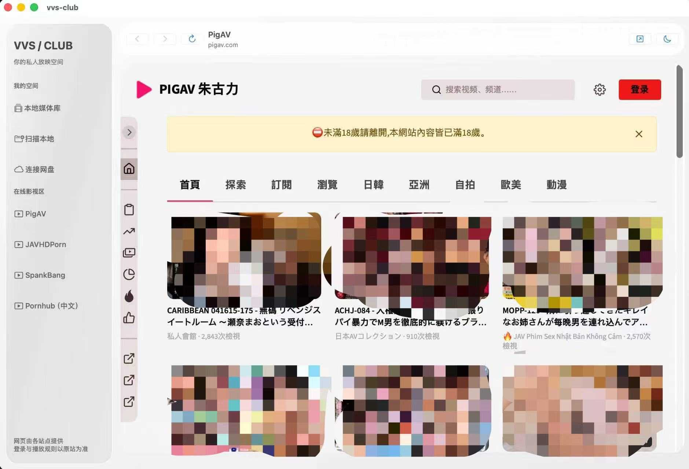

<p align="center"></p>

# 私人影院 看片利器

**vvs-club · 你的私人放映空间。**



把散落的影片整理成自己的媒体库，也给常用的在线站点留一个固定入口。vvs-club 面向个人使用：目录怎么放、资料怎么补、今天看什么，由你决定。

[Mac 应用](desktop/macos/README.md) · [运行与配置](docs/OPERATIONS.md) · [反馈问题](https://github.com/stanlll-cloud/vvs-club/issues) · [上游与更新](UPSTREAM.md) · [English](README.en.md)

## 一个窗口，两种看片方式

### 本地媒体库

连接硬盘、NAS 或已挂载的网盘目录，按人物、标签和作品资料浏览收藏。已有 NFO、海报和字幕可以接着用；缺少的信息按已配置的来源补充。扫描时不搬动原文件，改名、移动等整理操作另行执行。

影片版本、观看记录、收藏、筛选与播放偏好沿用 Peach 的本地媒体管理能力。远程来源需要你拥有相应账号和访问权；功能与限制见[运行文档](docs/OPERATIONS.md)和[来源说明](docs/SOURCING.md)。

### 在线影视区

Mac 窗口左侧为站点列表，右侧为独立网页浏览面板，带后退、前进、刷新和外部打开。已配置的六个入口为 PigAV、JAVHDPorn、SpankBang、Pornhub 中文站、MissAV 和 xHamster；各有独立按钮，不会自动加载站点首页。

此处只提供浏览入口。网页内容、账户与播放功能由原站提供，访问与验证规则照常生效。WebKit 不支持的播放器或无法连接的网站可在默认浏览器打开。不能保证所有网站都能播放。

## 在 Mac 上开始

在安装 Apple Command Line Tools 的 Mac 上，从仓库根目录构建：

```sh
python3 desktop/macos/build.py
```

先按[源码运行说明](docs/OPERATIONS.md#从源码运行windowsmacos)准备仓库的 `.venv`，再打开生成的 `build/vvs-club-macos/vvs-club.app`。选择「本地媒体库」时应用会启动本机服务，首次使用进入可视化设置。「扫描本地」可直接选文件夹；「连接网盘」可选择相应服务的同步或挂载目录。

Mac 外壳按当前机器架构构建，并连接构建时所在的源码与 `.venv`；这两个目录须保留。它没有内置独立 Python 运行时、FFmpeg 或媒体文件，暂不能只复制 `.app` 到其他 Mac。完整便携安装包、Developer ID 签名、公证与自动更新尚未提供。原项目下载站提供 Peach 原版，不是 vvs-club 的安装包。

网盘账号连接已改为「登录授权 → 选择云端目录 → 扫描影片」。五家网盘的连接代码已接入：百度、阿里、115 使用授权回调，夸克、TeraBox 使用官网独立登录会话。115 已验证授权与文件列表，其余账号及扫描播放仍待实测。官网提供哪些扫码或验证码登录方式，以实际页面为准。通过本机 OpenList 连接，部分授权与令牌刷新经过其在线服务；高级入口仍可使用已同步／挂载文件夹。详情见[网盘账号连接](desktop/macos/CLOUD_CONNECTIONS.md)。

## 自己维护入口

网站名称与地址保存在 [sites.json](desktop/macos/sites.json)。新增一项后重新构建，即可添加侧栏按钮。项目不导入系统浏览器凭据，不把个人媒体、数据库或站点 Cookie 上传 GitHub。

本地媒体服务继承上游的配置与可选诊断机制，使用前应查看[诊断字段及开关](docs/DIAGNOSTICS.md)。Mac 外壳本身没有新增遥测服务。

## 跟进更新

[UPSTREAM.md](UPSTREAM.md) 记录已采用的 Peach 提交和定制范围。上游功能、修复和新版本先检查差异，再决定是否合入，避免覆盖 vvs-club 的名称、介绍与在线入口。运行中不会因定期追踪而自动替换软件。

## 来源与许可证

vvs-club 基于 [Peach](https://github.com/peach-mitao/peach) 的开源代码。Peach 原作者：Copyright (C) 2026 longmeidao。vvs-club 的改名文案与 Mac 外壳为本衍生版本的修改；不代表 Peach 官方发布，也与列出的第三方网站不存在官方合作关系。

项目遵循 [AGPL-3.0-or-later](LICENSE)。原作者声明、第三方标识、组件许可及[复用清单](docs/REUSE.md)保留。技术包名 `peach`、CLI、数据库和协议标识维持兼容，不作为产品品牌展示。

仅管理自行持有或获授权使用的媒体，遵守适用法律、版权和来源平台条款；第三方成人站点仅限达到法定年龄且当地允许的使用者。应用不提供媒体资源或付费内容访问权。

## 搬瓦工机场 · Just My Socks

三网套餐可选，具体线路、支持运营商和地区以所选套餐的官方说明为准。

[](https://justmysocks.net/members/aff.php?aff=39372)

这是项目维护者的推广链接，通过该入口注册或购买，维护者可能获得佣金。此服务与软件使用无绑定关系，vvs-club 不是该服务的官方客户端。
